<h2 data-importer="text" align="left">Hi 👋! My name is Yomitha,</h2>

###

<h3 data-importer="text" align="left">Im a 13yo developer, Learning things from scratch.</h3>

###

<picture data-importer="pacman">
  <source media="(prefers-color-scheme: dark)" srcset="https://raw.githubusercontent.com/y0my0m/y0my0m/pacman-output/pacman-contribution-graph-dark.svg?game=pacman">
  <source media="(prefers-color-scheme: light)" srcset="https://raw.githubusercontent.com/y0my0m/y0my0m/pacman-output/pacman-contribution-graph.svg?game=pacman">
  
</picture>

###

 

  
  
  
  

###

  
  
  
  
  
  
  

###

  

###
